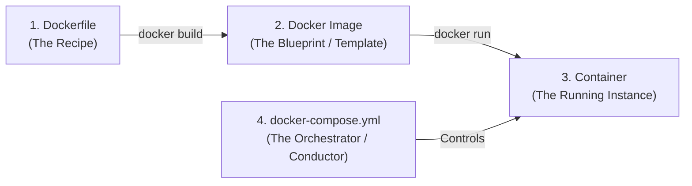
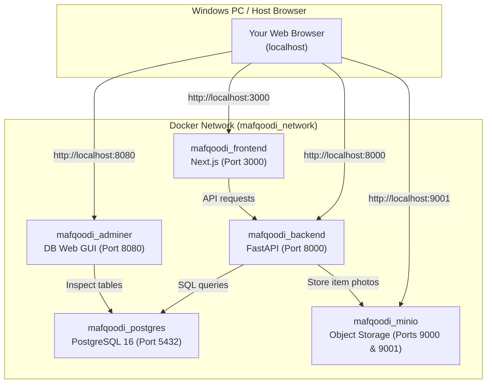

# Docker Complete Guide for Mafqoodi (مفقودي)

> [!NOTE]
> This guide is written specifically for developers new to Docker. It explains what Docker is, why we use it in Mafqoodi, how all components fit together, and how to run the entire platform with a single command.

---

## 1. What is Docker & Why Do We Use It?

### The Traditional Problem: "It works on my machine!"

Before Docker, setting up a project like Mafqoodi meant manually installing:

- Python 3.11 with specific libraries and C compilers
- PostgreSQL 16 database server and configuring local users/passwords
- Node.js 20 and npm for Next.js
- MinIO or an S3 simulator for file storage
- Various database tools and system dependencies

If your computer had a different version of Python, Windows permissions issues, or conflicting database ports, the setup would break.

### The Docker Solution: Standardized "Shipping Containers"

Docker packages an entire environment (the operating system, the exact programming language version, libraries, and your code) into a self-contained unit called a **Container**.

- If it runs inside a Docker container on one computer, it is **guaranteed** to run identically on any other computer (Windows, Mac, Linux, or Cloud Servers).
- You don't need to install PostgreSQL or Node.js directly on your Windows PC—Docker runs them isolated inside containers!

---

## 2. Core Docker Concepts in Plain English



1. **Dockerfile:** A text file containing step-by-step instructions to assemble an environment (e.g. "Start from Python 3.11, install requirements.txt, and run `uvicorn`").
2. **Docker Image:** An immutable snapshot built from a Dockerfile. Think of it as a frozen recipe or a CD-ROM.
3. **Docker Container:** A running, live instance of an image. You can start, stop, restart, or destroy containers in seconds.
4. **Volumes:** Storage that lives _outside_ the container on your computer. When a database container stops or restarts, your data isn't lost because it's saved in a Docker Volume.
5. **Port Forwarding (`host:container`):** Allows your Windows browser to talk to a service inside a container. For example, `8000:8000` routes `http://localhost:8000` from Windows directly into the FastAPI container.
6. **Docker Compose:** A tool that coordinates **multiple** containers at once. Instead of starting PostgreSQL, MinIO, FastAPI, and Next.js individually with 10 different commands, Docker Compose starts all of them together using one configuration file (`docker-compose.yml`).

---

## 3. The Mafqoodi Docker Architecture

Our `docker-compose.yml` orchestrates 5 interconnected services:



### Services Summary:

| Service        | Container Name      | Port                    | What it Does                                                                                         |
| -------------- | ------------------- | ----------------------- | ---------------------------------------------------------------------------------------------------- |
| **Frontend**   | `mafqoodi_frontend` | `http://localhost:3000` | The user interface (Next.js responsive web app).                                                     |
| **Backend**    | `mafqoodi_backend`  | `http://localhost:8000` | The REST API and AI matching engine. Interactive docs at `http://localhost:8000/docs`.               |
| **PostgreSQL** | `mafqoodi_postgres` | `5432`                  | The relational database storing users, reports, claims, and audit logs.                              |
| **Adminer**    | `mafqoodi_adminer`  | `http://localhost:8080` | A lightweight web page to view and edit database tables without installing database client software. |


---

## 4. How to Install Docker Desktop on Windows

Since Docker is not yet installed on your system, follow these 3 quick steps:

### Step 1: Download Docker Desktop

1. Go to the official download page: **[https://www.docker.com/products/docker-desktop/](https://www.docker.com/products/docker-desktop/)**
2. Click **Download for Windows**.

### Step 2: Run the Installer

1. Double-click `Docker Desktop Installer.exe`.
2. When prompted during installation, ensure **"Use WSL 2 instead of Hyper-V"** is checked (recommended default).
3. Follow the prompts until the installation completes, then restart your PC if prompted.

### Step 3: Open Docker Desktop

1. Open **Docker Desktop** from the Windows Start menu.
2. Accept the terms of service.
3. Wait until the status in the bottom-left corner turns **Green** ("Engine running").

---

## 5. Running Mafqoodi with Docker (Cheatsheet)

Once Docker Desktop is running, open PowerShell in `c:\Users\lenovo\Music\mafqoodi-platform` and use these commands:

### 1. First-time setup (Build and Start everything):

```powershell
docker compose up --build
```

> **What this does:** Downloads PostgreSQL and MinIO, builds the backend and frontend images, connects them to the network, and starts everything up.

### 2. Run in the background (Detached mode):

```powershell
docker compose up -d
```

> **What this does:** Starts all containers in the background so your terminal remains free.

### 3. View live logs:

```powershell
# View all logs in real time:
docker compose logs -f

# View backend logs only:
docker compose logs -f backend
```

### 4. Stop everything:

```powershell
docker compose down
```

> **What this does:** Safely stops all containers. Your database and uploaded photos remain completely safe in the persistent volumes!

### 5. Stop everything AND delete database data (Clean reset):

```powershell
docker compose down -v
```

---

## 6. Accessing Your Applications in the Browser

Once running, you can access all parts of the system directly from your browser:

- 🌐 **Web App:** [http://localhost:3000](http://localhost:3000)
- ⚙️ **API Documentation (Swagger UI):** [http://localhost:8000/docs](http://localhost:8000/docs)
- 🗄️ **Database Manager (Adminer):** [http://localhost:8080](http://localhost:8080)
  - System: `PostgreSQL`
  - Server: `postgres`
  - Username: `mafqoodi_user`
  - Password: `mafqoodi_secret_password_change_in_prod`
  - Database: `mafqoodi_db`
- 📁 **MinIO Storage Console:** [http://localhost:9001](http://localhost:9001)
  - Username: `minio_admin`
  - Password: `minio_admin_secret_password`

---

## 7. Hot Reloading / Live Coding

When you run Docker with our setup:

- Code changes you make in `backend/` or `frontend/` are **immediately reflected** without rebuilding!
- Volumes sync your local Windows files directly into the running containers.
